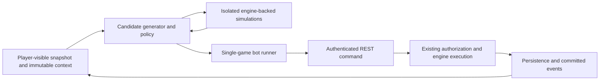

# AI Opponent Strategy

Status: proposed design, not an implemented feature. Researched 2026-10-31 against the current working tree, including its uncommitted roster and action-response fixes. Performance targets below are proposed acceptance criteria, not measured results.

**Recommendation:** prove an isolated engine-backed simulation boundary, build a deterministic heuristic opponent for both roles, then compare short heuristic-guided rollouts and beam search. Add chance-aware MCTS only when evaluation demonstrates useful improvement within a CPU budget. Do not start with reinforcement learning, an LLM, or a replacement game engine.

## 1. Problem Statement And Goals

Onion needs a playable opponent that can complete turns, pursue scenario objectives, and make intelligible tactical choices without creating another implementation of the rules. The asymmetric roles require different strategic priorities, but should use the same action, simulation, and evaluation contracts.

Initial goals:

- Play both Onion and Defender, including the Defender second-move phase.
- Produce only ordinary `MOVE`, `FIRE`, and `END_PHASE` commands.
- Respect server authority, canonical identity, scenario-local catalogs, and terminal/aborted sessions.
- Provide a reproducible offline evaluation loop before introducing production scheduling.
- Explain decisions through structured scores and candidate traces, rather than generated prose alone.
- Keep algorithms and deployment choices replaceable. A competent, bounded CPU opponent is more valuable initially than an unvalidated training pipeline.

The current snapshot exposes both sides' board state; treat the game as full-information with stochastic outcomes, not as chess and not as a hidden-information game. This observation permission does not include access to future match rolls, authentication data, or another participant's uncommitted UI selections. Difficulty should vary planning budgets and policy quality, not legality or privileged information.

## 2. Current Repository Capabilities And Hard Boundaries

The entry point remains [agent-start-here.md](agent-start-here.md). Existing contracts remain authoritative: [persistence.md](persistence.md), [api-contract.md](api-contract.md), [scenario-schema.md](scenario-schema.md), and [testing-strategy.md](testing-strategy.md). This proposal adds AI ownership; it does not redefine their rules.

| Capability | Verified owner | Consequence for AI |
| --- | --- | --- |
| Dynamic board | [shared/types/index.ts](../shared/types/index.ts) | Preserve `onions`, `defenders`, roster, naming, phase, and turn. Never place policy memory in `GameState`. |
| Scenario catalog | [rulesContext.ts](../shared/rulesContext.ts), [scenarioDefinitions.ts](../server/engine/scenarioDefinitions.ts) | Supply the immutable resolved match context explicitly to every rules/engine call. Do not silently use global values for derived types. |
| Unit values | [unitCatalog.json](../shared/config/unitCatalog.json) | Read movement, weapons, defense, stack limits, ramming profiles, and terrain capabilities through resolved definitions, not rules prose or type-name heuristics. |
| Move candidates | [movePlanner.ts](../shared/movePlanner.ts), [movementRules.ts](../shared/movementRules.ts) | Reuse reachable destinations and paths; these are not a complete command enumerator. |
| Move execution | [moveValidator.ts](../shared/moveValidator.ts), [movement.ts](../server/engine/movement.ts) | Validate before execution. Execution mutates the supplied state and has an injected ram roll source. |
| Combat evaluation | [combatCalculator.ts](../shared/combatCalculator.ts), [staticRules.ts](../shared/staticRules.ts), [targetRules.ts](../shared/targetRules.ts) | Reuse strengths, odds, target rules, and normalized terrain modifiers. Ridgeline cover is currently +1 defense where the catalog permits it. |
| Combat execution | [actions.ts](../server/engine/combat/actions.ts), [outcomes.ts](../server/engine/combat/outcomes.ts), [rolls.ts](../server/engine/combat/rolls.ts) | Validation and damage remain engine-owned. Execution accepts an explicit die value; the CRT is owned by `rolls.ts`. |
| Membership | [stackRoster/index.ts](../shared/stackRoster/index.ts), [actionSubject.ts](../shared/actionSubject.ts) | Resolve opaque group IDs and stable member IDs from the roster. Co-location is occupation data, not canonical membership. |
| Naming | [stackNaming/index.ts](../shared/stackNaming/index.ts) | Preserve display-name lifecycle, but never use names as tactical identity. |
| Phase transitions | [phases.ts](../server/engine/phases.ts), [game.ts](../server/engine/game.ts) | Use `phaseActor()` and `advancePhaseWithEvents()`. Recovery is automatic, not an AI action. |
| Victory | [engine/victory.ts](../server/engine/victory.ts), [API/victory.ts](../server/api/gameHelpers/victory.ts) | Evaluate all required objectives for a role. Preserve scenario type resolution and history needed for completion. |
| Commit boundary | [actionRoutes.ts](../server/api/gameRoutes/actionRoutes.ts), [move.ts](../server/api/gameRoutes/actionHandlers/move.ts), [fire.ts](../server/api/gameRoutes/actionHandlers/fire.ts) | REST authorization and validation remain mandatory. Search must never call persistence/finalization to explore a branch. |
| Snapshot boundary | [stateProjection.ts](../server/api/gameHelpers/stateProjection.ts), [protocolSchemas.ts](../shared/protocolSchemas.ts) | Require valid canonical input and reject malformed snapshots. No legacy migration or AI-specific inference. |

Important limitations and details discovered during inspection:

- There is no general clone-and-step API or complete legal-action generator. Pure-looking engine calls still mutate their input; the simulation adapter must own an isolated clone.
- MOVE orchestration deduplicates movers, validates/executes them sequentially with roster reconciliation disabled, and reconciles once after all movers. A simulator must reproduce that transaction boundary, including all-or-nothing publication if a later mover fails.
- FIRE attackers are Onion weapon IDs or Defender unit IDs, depending on phase. `onionId` scopes the firing Onion or the targeted Onion. A grouped Defender target uses its roster group ID; treads use `formatCombatTargetId()` and the exact `{onionId}:treads` contract.
- Multi-unit tread attacks require attackers from one canonical stack. Defender fire spends the attacker's available firing opportunity as implemented by the engine; it does not expose arbitrary per-weapon Defender commands. Onion missile fire also spends other ready missile launchers for that turn. Planning must value these opportunity costs.
- Current tread execution uses a 1:1 CRT exchange by setting defense to attack strength. Non-X results do not damage Onion systems. Against a Little Pigs stack, current execution applies non-X results to one live member and X to all live members. Do not model a generic D/X damage fraction independently of the engine.
- [targets.ts](../server/engine/combat/targets.ts) is a coarse maximum-range helper: it can return individual grouped Defender IDs and only tread IDs for Defender attacks. It is not an authoritative list of legal FIRE commands or all subsystem targets.
- GET snapshots omit static catalogs. The match-resolved catalog arrives through WebSocket `SESSION_INIT`; commands over WebSocket currently return `NOT_IMPLEMENTED` in [websocketRoutes.ts](../server/api/gameRoutes/websocketRoutes.ts). REST is the wired commit transport.
- The public scenario endpoint reads scenario files, not necessarily the immutable snapshot stored with an existing match. A same-ID scenario fetched later is not enough to prove simulation context matches that game.
- `snapshotRevision` is snapshot freshness; event sequence is an event cursor. The REST command schema has neither a client expected revision nor an idempotency key. `causeId` is currently derived from the server request ID, not a client deduplication guarantee.
- Current victory evaluation declares `maxTurns` in its input type but does not enforce a turn-limit result. Do not invent a simulator-only winner at that limit. Harness cutoffs must be reported as truncations until a separate game-rule decision is approved.

## 3. Candidate Architectures

Policy placement and player identity are separate choices. A server-owned AI account can be driven by either an external process or an in-process scheduler; it is not itself a scheduling architecture.

| Model | Authority and concurrency | Timing, observability, scaling, and tests | Roles and UI |
| --- | --- | --- | --- |
| External authenticated bot | Reads player-visible snapshots/catalog, submits ordinary REST actions. One command in flight per game; serialize locally and reload on conflicts. No privileged database writes. | Event polling or WebSocket notifications trigger fresh reads. Separate process isolates CPU cost and crashes; logs correlate decision IDs to returned event fences. Easy to exercise with injected transport and `app.inject()`. Multi-worker ownership later needs a lease. | Both roles. Existing board/action UI works; REST-only bots appear disconnected to current WebSocket presence. |
| In-process opponent service | Policies still receive a filtered observation. A scheduler may invoke an authorized internal command service, never engine mutation plus direct DB persistence. Must recheck role/lifecycle/freshness at execution. | Easy access to immutable match context and lifecycle triggers, but CPU search must leave Fastify's event loop. Restart recovery, queue deduplication, leases, and worker limits are additional production work. | Both roles. Presence and bot lifecycle must be specified; normal committed snapshots still drive the UI. |
| Server-owned AI player account using REST | Provision an ordinary participant with server-managed credentials; do not give it administrative access or a special legality bypass. Account identity does not prevent overlapping workers or human sessions. | Existing auth, joins, starts, and event logs apply. Credential provisioning, account reuse across games, and account/session restrictions need an explicit operations design. | Both roles. A display name suffices for manual games; one-click AI creation requires lobby/provisioning changes. |
| Reusable policy module used by bot and tests | A deterministic policy receives read-only context and returns a command, never writes a match. This complements either scheduler above. | Same policy/version evaluated offline and online. Candidate traces and fixed budgets are testable without HTTP or React. Keep engine-backed implementation in the backend, not in the browser bundle. | Role parameter selects priorities. No UI dependency. |
| Development-only simulator/harness | Owns local copies, not real matches. Engine functions decide all outcomes. Test fixtures can provide exact immutable scenario context. | Fastest route to parity tests, seed-controlled matches, and throughput measurements. No account, deployment, or presence work. Does not itself provide a production opponent. | Tests can alternate both roles. No UI change. |

### Runtime Loop And Stale Plans

After each notification or polling tick: fetch a current snapshot, require an active non-aborted game and the bot's `phaseActor`, obtain matching static context, decide within budget, check freshness, submit one command, then rebuild candidates from the returned/fetched snapshot. Duplicate notifications are wakeups, not instructions to replay a command. Stop immediately on terminal status or role handoff; use `END_PHASE` rather than waiting for all resources to be exhausted.

Treat `409 STALE_STATE` as discard-and-replan, `403 NOT_YOUR_TURN` as stop-and-refresh, and `409 GAME_OVER/GAME_ABORTED` as terminal. A same-revision 422 indicates a policy/simulator defect: record it and stop that decision rather than repeatedly sending an illegal command. Bounded transport retries must distinguish reads from writes. After a timeout on a POST, the command may have committed; reconcile snapshot and events first and pause for operator recovery if the outcome remains ambiguous. A pre-submit GET reduces stale planning but cannot close the GET/POST race.

For a manually supervised single-worker prototype, exclusive ownership of the bot account/game plus sequential submission is acceptable. Before unattended or multi-worker production, approve an optional revision precondition and idempotency contract, or an equivalent authorized internal command service with atomic freshness checks. Existing DB compare-and-swap protects overlapping writes after route loading; it does not prove that a command was chosen from the current observation. Preserve structured backend errors.

### Simulator, Direct Policy, Preview API, Or REST Only?

- **Isolated engine-backed simulator:** recommended. Supports rollouts, reproducible evaluation, and later training; requires transaction and victory parity tests.
- **Policy directly calls engine functions:** appropriate inside the simulation adapter on owned clones, not on live match references. Without an adapter, clone ownership and grouped-action sequencing will be duplicated across policies.
- **Server preview/evaluation endpoint:** defer. It could later supply matching context or legal candidates to third-party bots, but creates resource-abuse, authentication, revision-binding, and versioning obligations. Never accept a client-selected production roll or mutate match randomness during previews.
- **REST-only bot:** viable for a basic no-lookahead policy and integration proof, not for speculative search. Trial actions are real commits and cannot be rolled back. Catalog and immutable scenario-context access remain prerequisites for rule-correct evaluation.

## 4. Search, Simulation, Learning, LLM, And Existing-Engine Comparison

| Approach | Playability and strength | Cost and failure modes | Verdict |
| --- | --- | --- | --- |
| Scripted heuristics | Fastest playable baseline: objective priorities, threat-aware movement, cover, target value, CRT thresholds, and resource conservation. Predictable and explainable. | Brittle at combined-fire allocation, move ordering, baiting, and new scenarios. Requires tactical fixtures and tuning, but no training infrastructure. | First policy; permanent fallback and benchmark opponent. |
| Beam search | Keep a small set of promising action sequences; good for same-role phase planning and weapon allocation. | Pruning can remove necessary setup actions; opponent response needs an explicit model. A beam score is not a minimax guarantee. | Compare after the baseline, especially for combat sequences. |
| Minimax / expectiminimax | Useful on small tactical trees. Expectiminimax handles chance probabilities; plain minimax applies only to deterministic branches or a deliberately approximate model. | Branches multiply over movers, destinations, attacker subsets, and rolls. Worst-case full-turn trees are impractical without strong pruning. | Use as a tiny-fixture oracle, not the initial whole-game engine. |
| MCTS | Anytime search with sampled outcomes and selective allocation of work. Suitable for longer tactical dependencies once candidates and rollouts are good. | Weak random rollouts, sparse victory rewards, huge action sets, and horizon bias can make it worse than heuristics. Requires chance-aware branching, correct player perspective, and memory/CPU caps. | Conditional next-stage experiment, not an assumed improvement. |
| Heuristic plus rollouts/MCTS | Heuristics provide candidates and leaf/rollout policies; simulation estimates downstream effects and opponent response. | Inherits pruning bias and rollout-policy blind spots. Must preserve some exploration and measure ablations. | Likely practical medium-term baseline; root rollouts are simpler than a full tree. |
| Reinforcement learning / self-play | Can learn allocation and positioning beyond hand-authored weights; inference may be cheap after training. | Needs fast trusted simulation, masked variable actions, diverse training, reward design, model/version artifacts, and repeated retraining after rule changes. Sample needs are unknown. | Defer until measured search limits and an owned training budget justify it. |
| LLM-assisted policy | Can propose high-level goals or rank a small structured action shortlist; useful as an offline analysis/tuning assistant. | Remote latency and recurring cost, limited tactical arithmetic, large state/prompts, nondeterminism, provider changes, and prompt injection through names/descriptions. No reliable optimality or legality guarantee. | Optional experiment behind the same policy interface; not default live tactics. |

### Search Size And Horizon

For $u$ individual movers with $h$ average destinations, atomic movement candidates start around $u h$; joint move plans and their order grow much faster. A group of $g$ members has up to $2^g-1$ nonempty selections. The current global Little Pigs limit is five, but read scenario-resolved limits rather than assuming that bound forever. An undamaged catalog Onion has 15 weapon instances, giving $2^{15}-1$ nonempty subsets before target/range/missile filtering. Different firing orders can change both resource availability and target survival.

A simulation edge should be **one REST-shaped command**, not an individual member execution. Depth should count role/phase boundaries as well as commands: Onion Move and Onion Combat belong to the same player; Defender Move, Combat, and Second Move likewise. Do not negate utility after every command. Negamax sign changes belong at role changes; chance nodes weight/sample outcomes rather than maximize them.

Start with greedy one-step ranking, then complete the acting side's phase/turn with a heuristic continuation and simulate one opposing response before leaf evaluation. Benchmark one full round as a maximum rollout horizon before increasing it. Preserve separate command, phase, and simulation-count limits so a phase with many units does not consume the entire horizon unfairly. Replan after each committed action; an offline macro-plan is not an atomic public API turn.

For MCTS, search decision nodes by actor and branch/sample chance outcomes separately. Revisiting the same FIRE must not permanently freeze the first sampled roll. Use progressive widening of actions, heuristic priors, bounded nodes, and a small exploration allowance outside the initial shortlist. Start without tree reuse or transposition merging; add them only after state-key and freshness tests.

### Existing Libraries: Researched Fit

These are primary-source findings, not installed or benchmarked integrations. Links were checked on the research date; pin a release/commit and recheck maintenance, license, Node/ESM support, and security before adoption. No reviewed library supplies Onion's game rules.

| Library | Verified capability and support evidence | Integration with Onion | Decision |
| --- | --- | --- | --- |
| [boardgame.io](https://github.com/boardgameio/boardgame.io), MIT | TypeScript turn-based framework with phases, multiplayer, and bots. Its [MCTS implementation](https://raw.githubusercontent.com/boardgameio/boardgame.io/main/src/ai/mcts-bot.ts) requires `Game`, move enumeration, framework state, and `CreateGameReducer`; supports seeds and playout limits. Repository shows recent activity, but package compatibility remains untested. | Hexes/groups can be opaque data, but adopting its runtime would duplicate current turn/storage authority. Its [random plugin](https://raw.githubusercontent.com/boardgameio/boardgame.io/main/src/plugins/random/random.ts) stores PRNG state: seeding alone is not proof that chance outcomes are resampled properly for search. Requires an adapter and chance tests, not a drop-in bot. | Do not migrate engines. Consider only an isolated adapter if a spike proves less work than a local search shell. |
| [OpenSpiel](https://openspiel.readthedocs.io/en/latest/developer_guide.html), Apache-2.0 | C++/Python game framework; [MCTS source](https://raw.githubusercontent.com/google-deepmind/open_spiel/master/open_spiel/python/algorithms/mcts.py) explicitly handles sequential games with chance nodes, terminal rewards, seeded sampling, and custom evaluators. Dedicated developer docs and tests. | Strong stochastic-search fit, no verified direct Node interface. Custom hex/phase/stack actions need game/state adapters and integer action mapping. Keep the TS engine authoritative via a local service/IPC bridge; a Python rules rewrite is unacceptable. Per-step IPC may dominate throughput. | Best external research option after the TS simulator exists; benchmark batched calls before committing. |
| [Yuka](https://github.com/Mugen87/yuka), MIT | JavaScript state/goal-driven agents, navigation, steering, perception, and fuzzy logic. Retrieved repository shows an older release/activity baseline. | Goal arbitration could help a larger scripted policy, but not a documented stochastic board-game search core. Its navigation must not replace shared hex movement. TypeScript packaging and chance support would need separate verification. | Unnecessary for the first priority/scoring policy; reconsider only if goal-management complexity grows. |
| [npm mcts](https://www.npmjs.com/package/mcts) | Generic possible-moves/current-player/winner interface; retrieved package 0.0.8 was published nine years ago and declares no license. Documentation does not establish explicit chance-node or reproducibility support. | Opaque hex commands are possible, but cloning, stochastic revisits, budgets, types, and same-player action sequences need an audit. | Reject initial adoption on maintenance/license/contract evidence. A small package name is not evidence of fitness. |
| [Gymnasium](https://gymnasium.farama.org/introduction/create_custom_env/) and [PettingZoo AEC](https://pettingzoo.farama.org/api/aec/) | Documented Python environment contracts for reset/step, observations, termination/truncation, multi-agent sequencing, and optional legal-action masks. | Custom wrappers can represent asymmetric players and phases; repeated commands may leave the same player active. They provide environment infrastructure, not search or Onion mechanics. Bridge to TS simulation, not live REST matches. | Preferred environment boundary if learning is approved later. Pin/audit dependencies then. |
| [SB3-contrib MaskablePPO](https://sb3-contrib.readthedocs.io/en/master/modules/ppo_mask.html) | Existing masked PPO learner with Discrete/MultiDiscrete/MultiBinary actions, Dict observations, and mask-aware evaluation. Documented recurrent-policy limitation. | Needs a stable bounded action schema or padded candidate set with features and masks. Dynamic shortlist indices alone are not stable semantic actions. PettingZoo requires an additional training wrapper/opponent schedule; PPO is not an automatic two-player self-play controller. | Conditional learning baseline; not an initial dependency. |
| [RLCard](https://github.com/datamllab/rlcard), MIT | Card-focused environments, legal actions, seeded runs, step-back support, RL/search examples. Retrieved release/activity evidence is older. | A custom hex game could be wrapped, but built-in card models/action encodings provide little advantage over a general environment bridge. | Not preferred; no chess/checkers/card engine is a substitute for this engine. |

Do not add a generic rules engine: legality is already structured and owned. Prefer reusable search/environment algorithms only when their adapter is cheaper, testable, and chance-correct. If no compatible maintained library meets those conditions, a small tested beam/root-rollout coordinator is justified; it must not contain movement or damage rules.

## 5. Recommended Initial Architecture

Use a backend-only reusable policy module, an engine-backed isolated simulator, and a development match runner. After parity and policy gates pass, connect the same module to one external Node bot using a normal player account and REST commits. This isolates expensive planning without introducing a production queue immediately.

Proposed ownership, not new files created by this design:

- `server/engine`: isolated command stepping and reusable domain execution; existing movement, combat, phase, and victory functions remain owners.
- `server/ai`: candidate generation, feature scoring, policies, search, and decision tracing. No imports from React or persistence adapters.
- `shared`: existing rules/contracts; add only genuinely cross-process observation/trace contracts if needed, not another AI rules facade.
- `scripts`: offline evaluation runner; reuse canonical test utilities and fixtures.
- A bot transport/scheduler owns credentials, refresh, deadlines, and lifecycle, separate from policy decisions.



No search branch reaches persistence. The authoritative server revalidates the selected command even if the simulator accepted it. Shared policy code is reused by tests and the bot process, not shipped to web to commit game state locally.

## 6. Proposed Simulator/Policy/Action Interfaces

The following are contract sketches, not implementation code or existing APIs. Reuse `Command`, `GameState`, `RulesContext`, `EventEnvelope`, and scenario/victory types rather than defining parallel domain models.

```text
SimulationContext
  immutable scenario snapshot and resolved objective configuration
  resolved RulesContext and materialized map
  engine/scenario/catalog version hashes

SimulationSnapshot
  GameState, event history, lifecycle status, winning role, aborted flag

simulateStep(context, snapshot, actorRole, Command, explicitRollTape, clock)
  -> success(nextSnapshot, engineResults, generatedEvents, consumedRolls)
   | structuredFailure(code, detailCode)

generateCandidates(context, snapshot, actorRole, generationBudget)
  -> validated candidates, coverage mode, generated/rejected/pruned counts

evaluateState(context, snapshot, perspectiveRole, weightVersion)
  -> bounded utility and named feature contributions

decide(observation, candidates, optionalSimulator, policySeed, decisionBudget)
  -> selected candidate, scores, counts, rationale codes, stop reason
   | notActive | terminal | diagnosticFailure

BotTransport
  readSnapshot(gameId, sinceRevision?)
  obtainMatchingContext(gameId)
  readEvents(gameId, afterSeq)
  submitCommand(gameId, Command)
```

`SimulationContext` is shared read-only; serialize definitions/configuration, not `RulesContext` methods, across process boundaries and reconstruct through existing context factories. A policy observation includes only permitted game/context data, current revision/event cursor, role, and optional local policy memory. It contains no DB objects, credentials, live RNG, or predicted future rolls.

### Required Step Semantics

1. Validate canonical input and context/version correspondence. Invalid snapshot shapes are diagnostic failures, not positions to repair, rename, or regroup heuristically.
2. Parse the ordinary command schema and require correct phase actor, active lifecycle, and nonterminal state. No simulation-only action permissions.
3. Clone mutable state and branch-local history before invoking the existing engine. Do not leak aliases to the root snapshot or another branch.
4. MOVE delegates single-unit validation/execution and reconciles once per command; a failed multi-mover action discards the entire local transaction. FIRE delegates validation and execution with an explicit valid d6. END_PHASE delegates `advancePhaseWithEvents()`, including recovery and cleanup.
5. Reuse event construction and resolved scenario victory adaptation in the same order as authoritative handlers. Preserve winner lock-in. Do not independently interpret objective prose or choose new precedence if objectives complete simultaneously.
6. Return next state, events, and roll consumption without DB, broadcast, traffic logging, or live random consumption. Canonical output must satisfy the same snapshot contract.

Initially wrap one MOVE as a small simulation probe; do not extract the whole API dispatcher at once. Before full simulation is relied upon, factor reusable no-I/O command execution into the engine boundary and have both the simulation adapter and authoritative handlers call it. Keep auth/persistence/broadcast in API modules. Extract only the necessary pure event/victory adaptation; keep the index current when actual owners move. Differential tests are mandatory during this refactor so orchestration does not become a second implementation.

Generated timestamps and request IDs are not tactical values. Inject a deterministic clock for harness events, and compare semantic state/events in parity tests while explicitly ignoring transport-generated IDs/timestamps. Preserve history for objective evaluation; compress it into completion facts only after tests prove that reduction sufficient for every supported objective. Never carry a simulated winner, roll, or next state in a real POST command.

## 7. State Representation And Legal-Action Generation

### State And Evaluation Features

Start with canonical object state and `structuredClone` at the adapter boundary. Share immutable map/catalog context. Derive indexes for units, occupancy, ready weapons, and roster membership without mutating or persisting them. Occupancy maps may group positions for movement/threat calculations, but never define stack identity.

Score from an explicit role perspective using completed/remaining scenario objectives, route progress, survivable firing positions, expected useful damage, tread mobility bands, ready weapon resources/ammo, threat exposure, covered infantry, and Defender second-move escape options. Onion should pursue its required objectives while preserving useful mobility; Defender should protect objective units and attack mobility or dangerous subsystems. Unit/weapon costs are optional inputs, not a complete strategic value function. Do not score cosmetic names, group ordinal magnitude, or UI selection.

For transposition keys later, include role/phase/turn, per-unit movement spent, all weapon states/ammo, treads/ram allowance, canonical group IDs and allocation history, objective/history facts, scenario/catalog/engine hashes, and terminal status. Preserve member order: current stack damage can affect the first live member. Sorting member arrays or merging apparently identical weapons/members without proof may change observable behavior. Keep reproducible simulation RNG state in replay keys; chance-aware search must not treat a hidden future authoritative seed as part of the player's decision state.

### Movement Candidates

- Enumerate individual operational movers using phase-aware allowances from [unitMovement.ts](../shared/unitMovement.ts). Use `listReachableMoves()` with materialized cells, live occupancy, mover exclusions, resolved rules, and the intended incoming member count. Exclude same-position/zero-progress commands from policy candidates, even if a validator accepts them.
- Validate each proposed MOVE against the engine. Reachability alone does not account for all ram/resource constraints.
- Add whole-group and selected-member candidates only from canonical roster membership. Different remaining allowances require per-member checks; do not use one representative's allowance for all members. Prototype candidates may deliberately omit cross-group/joint moves, but must label that as restricted coverage rather than declaring those commands illegal.
- Preserve the API's sequential multi-mover execution/reconciliation boundary in validation and simulation. For small fixture states, enumerate all nonempty member subsets to compare the restricted generator with a broader oracle.
- For Onion moves, consider `attemptRam: false` and `true` where the validated path yields a meaningful difference. The wire contract chooses a destination, not a custom path; search cannot select an alternate ram route absent a separate approved protocol change.

### Combat Candidates

- Read ready weapons through [unitState.ts](../shared/unitState.ts) and [unitWeapons.ts](../shared/unitWeapons.ts). Resolve target IDs from canonical units/groups, structured tread targets, and individually targetable Onion weapons scoped by `onionId`.
- Use shared range/target/calculator helpers for prefiltering and the full `validateCombatAction()` for final legality. Do not treat the coarse `getValidTargets()` output as a complete legal set.
- Begin with individual FIRE candidates plus combined-fire candidates near CRT strength thresholds. Generate same-group tread combinations; do not combine ungrouped units or separate groups for tread attacks. Expand other combinations under budgets and validate each.
- Prefer minimal resource sets that achieve a useful odds threshold, but retain alternatives with different target, ammo, or future-fire value. Identical attack totals do not imply interchangeable attackers.
- Recompute after every simulated or committed FIRE. Account for target destruction, disabled/recovering units, stack casualty order, spent weapons, and missile opportunity costs through resulting engine state.

### Completeness And Budgets

A bounded candidate generator is **sound but intentionally incomplete**: every emitted candidate is legal for its input, but some legal commands may be omitted. Return `restricted`, `pruned`, or `exhaustive-small-fixture` coverage plus counts. A random baseline using this generator is random over its documented candidate set, not uniformly random over all possible game commands.

Always include legal `END_PHASE` while the player is active, including when useful moves/attacks exist. Stop on terminal/abort before generating it. Cap candidate generation separately from search and cap total work per role turn, not just per command. On budget exhaustion use the best validated heuristic candidate or `END_PHASE`; on malformed context/snapshot, fail diagnostically instead of hiding the error with a pass. A harness action limit truncates evaluation, never changes game victory.

## 8. Randomness And Reproducibility Strategy

Use three independently versioned random domains:

| Domain | Purpose | Ownership |
| --- | --- | --- |
| Policy/search seed | Tie-breaking, exploration, rollout assignment | Bot/harness only; never reveals future match randomness. |
| Planning outcome seeds/tapes | Sample hypothetical combat and ramming | Branch-local simulator. Fork deterministically by decision/rollout and roll type; record consumed values. |
| Authoritative evaluation seed/tapes | Actual outcomes of controlled offline/test matches | Runner or injected test server; not accessible to either policy. Production randomness is unchanged. |

Existing seams: `executeCombatAction(..., roll, rules)` accepts an explicit combat die; movement accepts `ramRolls.next()`; [context.ts](../server/api/gameRoutes/context.ts) maintains per-game sources; [e2eRamRolls.ts](../server/engine/e2eRamRolls.ts) creates fresh finite queues and throws on exhaustion. Reuse these seams, but do not treat an E2E queue as a general seeded PRNG or share the mutable route-context source with search.

Require uniform independent d6 sampling unless the engine contract changes. For short tactical FIRE evaluations, enumerate rolls 1 through 6 and execute each on an isolated copy. Expected action value is

$$
Q(s,a)=\frac{1}{6}\sum_{d=1}^{6}V(\operatorname{step}(s,a,d)).
$$

This uses real target-specific damage, rather than a copied CRT or a fractional average unit state. Ramming consumes a roll per rammed unit; exact enumeration costs $6^k$ for $k$ rolls. Use it on tiny fixtures and sampled rollouts elsewhere. The global catalog currently allows two rams, but obtain limits from resolved rules. Larger scenario-local limits must not break enumeration budgets.

Use seeded sampled rollouts for longer continuations, with common random numbers across candidate comparisons where roll roles can be aligned. Extra rolls in one action must not silently shift unrelated combat streams. Separate ram/combat/tie-break streams; record tapes because different commands consume different numbers of draws. Paired seeds reduce evaluation noise, but do not promise identical events across different policies.

Fixed seeds plus fixed simulation counts and stable candidate ordering define deterministic tests. Wall-clock deadlines and parallel scheduling can produce different choices on different machines; record hardware/runtime, completed work, and chosen action, and test them as bounded-latency modes rather than bit-identical policies. Never monkey-patch global `Math.random()` or expose a production seed to the policy.

Authoritative production replay should rely on recorded outcomes/rolls, not assume current Math.random state can be restored after restart. Persisted private seeded match RNG would be a separate architectural/DB contract, not required for this first AI milestone. Trace policy reproducibility and outcome replay separately.

## 9. Training Or Tuning Strategy

### Initial Tuning Without Learning

Version named heuristic weights and search budgets. Start with objective-first rules, then tune threat, mobility, combined-fire efficiency, cover, and resource-conservation weights on an explicit training fixture/scenario split. Keep tactical and seed holdouts inaccessible to tuning. Use grid/random parameter search before adding optimization libraries. Compare greedy, beam, root rollouts, and MCTS at equal end-to-end CPU budgets, including candidate generation.

Ablate candidate pruning, opponent rollout strength, horizon, chance sample count, and individual feature families. A stronger policy must not merely exploit a weaker candidate generator in the baseline. Keep a frozen heuristic version, a documented random-action baseline, and older policy versions in the opponent pool; inspect failure replays manually.

### Conditional Learning/Self-Play

No repository evidence establishes player population, game-log volume, or training throughput. A human population is not necessary for self-play, but it matters for validating a bot against real play. Current fixed scenarios and asymmetric actions alone do not justify ML expenditure.

If the learning gate is approved, first measure a simulator-throughput and sample-efficiency pilot. Consider behavior cloning from verified heuristic/search traces before RL; it can reduce inference cost without claiming new tactical strength. For RL:

- Encode unit/weapon records and canonical roster relationships with phase/role, map geometry/terrain, objectives, and resolved type features. Use padded sets/graphs or candidate features rather than treating arbitrary opaque IDs as learned numeric magnitudes.
- Supply legal masks from the same generator/validator used in evaluation. Use stable semantic factorization or bounded candidate slots with candidate features, deterministic mapping, overflow diagnostics, and a masked END_PHASE slot. Candidate pruning limits what a learner can discover.
- Use terminal win/loss rewards with reported truncations separate from draws. If shaping is necessary, use bounded potential-based objective progress and ensure passing/oscillation cannot farm reward. Do not optimize only raw damage or unit kills.
- Curriculum: deterministic tactical fixtures, sampled dice, then small complete matches, terrain/stack variants, and validated scenario-local catalogs. Expand using the existing scenario schema, not a shadow game generator.
- Train both roles against a frozen mixture of opponents and historical checkpoints, not only the latest self. Track per-role/per-scenario regression, exploitation, and held-out human review.
- Budget simulator steps, wall time, CPU/GPU use, and at least three independent training seeds explicitly. Estimate required volume from pilot learning curves; do not promise a fixed number of games to reach strength.
- Version engine/catalog, encoding, masks, curriculum, rewards, checkpoints, and inference runtime. Rule changes can invalidate traces and require retraining. No unattended online learning in live games initially.

### Optional LLM Experiment

Let an LLM choose a strategic mode or return one ID from a small structured legal shortlist. It never supplies executable code, arbitrary commands, rolls, or a new state. Parse strictly, require membership in the current revision-bound shortlist, revalidate, and fall back to the local policy on timeout or invalid output. Recheck freshness after the remote call.

Send compact numeric features and objective status, not the full event log or irrelevant display naming. Treat player names, scenario descriptions, and event text as untrusted data; omit them where possible. No tools, filesystem, credentials, or unrestricted network access. Cache only against complete context/revision/policy inputs. Evaluate token volume, latency, cost per completed game, refusal/invalid-choice rates, prompt sensitivity, and tactical fixtures against the CPU baseline. Temperature zero is not a cross-version determinism guarantee; retain requests/responses and exact model configuration subject to privacy rules.

## 10. Evaluation Scenarios And Metrics

### Existing Anchors

| Anchor | Evaluation purpose |
| --- | --- |
| [test/server/engine](../test/server/engine) | Differential execution, rolls, damage, phases, terminal evaluation, and scenario normalization. |
| [movePlanner.test.ts](../test/shared/movePlanner.test.ts), [moveValidator.test.ts](../test/shared/moveValidator.test.ts) | Terrain costs, legal cells, occupancy, stacking limits, allowance, and ram legality. |
| [combatCalculator.test.ts](../test/shared/combatCalculator.test.ts), [stackRoster.test.ts](../test/shared/stackRoster.test.ts) | Strength/modifier scoring, canonical membership, split/merge, singleton behavior, and stable IDs. |
| [games.actions.move.test.ts](../test/server/api/games.actions.move.test.ts), [games.actions.combat.test.ts](../test/server/api/games.actions.combat.test.ts), [games.actions.phase.test.ts](../test/server/api/games.actions.phase.test.ts) | REST parity, events, atomic failures, stale-state handling, authorization, recovery, and winner locking. |
| [integration.integration.test.ts](../test/server/api/integration.integration.test.ts) | Full-turn/multi-turn orchestration, first-move stack regressions, split singletons, and terminal rejection. Run using the existing integration profile. |
| [swamp-siege-01.json](../scenarios/swamp-siege-01.json) | Baseline full-match scenario and phase sequencing, both roles. |
| [onion-ring-iii.json](../scenarios/onion-ring-iii.json) | Larger board, four five-member infantry groups, movement/fire ordering, and multiple required Onion objectives. |
| [e2e-colocation-01.json](../scenarios/e2e-colocation-01.json) | Canonical group targets, adjacent occupants, scenario-derived Wolf movement, and catalog correctness. Tactical fixture, not a balanced win-rate benchmark. |
| [benchmark-projection.ts](../scripts/benchmark-projection.ts) | Existing timing/warmup/reporting pattern and snapshot-projection overhead. It is not a simulation-throughput benchmark. |

Reuse fixture utilities in [gameStateUtils.ts](../test/utils/gameStateUtils.ts) and API helpers in [helpers.ts](../test/server/api/helpers.ts). Add focused behavior tests in the existing engine/shared/API layers; do not introduce React or a DB into pure policy tests. Use a small E2E journey only after bot integration: create/join/start, AI completes its role turn, human refresh/reconnect sees committed state, terminal stops further AI actions.

Required tactical cases: objective win versus high-damage distraction; minimizing resources for a CRT threshold; avoiding overkill; protecting an immobile objective; ram success/failure and tread-band loss; covered infantry versus exposed infantry; stack split/reform and same-group tread fire; disabled/recovery timing; second-move retreat; spent missile constraints; no useful action; malformed snapshot; wrong role; terminal/aborted state; stale response and ambiguous POST outcome. Include multiple Onions and scenario-local definitions as contract tests even if the first playable scenario has one Onion.

### Metrics And Experimental Protocol

Measure win/loss/truncation rates against frozen heuristic and random-candidate opponents, separately for scenario and role. Report objective completion and time/actions to completion; do not turn truncated games into arbitrary winners or hide them in the win-rate denominator. On decisive games report win rate alongside all-game results and truncation rate.

Record p50/p95/p99 decision latency, complete role-turn time, candidate generation time, candidates generated/validated/pruned/selected, actual simulation steps per second, rollout length, peak nodes/memory, invalid actions on unchanged snapshots, stale conflicts/replans, timeout/fallback rate, and repeated seed choice/state hashes. Measure throughput with real valid simulation states, logging disabled for hot loops, warmups, and stated hardware/Node version; do not mistake projection timing for engine speed.

Tactical quality uses acceptance sets of reasonable actions or regret against an exact small-tree oracle; it must allow equally good alternatives and account for chance. Review blinded full-game replays for pass loops, objective neglect, exploitation, and readable pacing. Scale unit count, group size, board size, and available weapons in valid fixtures, and report latency/memory degradation rather than one aggregate score.

Start comparative experiments with 100 paired outcome seeds per scenario/role against each baseline. Increase sample count when confidence intervals are inconclusive. Report a 95% interval and paired-match differences; do not infer strength from a few lucky wins or from pooled results that mask a losing role. Hold out scenario variants and seed batches from tuning. Performance gates use a fixed reference machine and include candidate generation and IPC/network overhead where applicable.

### Replay/Evaluation Record

Use versioned JSON Lines: a run manifest, a decision record per action, and a final match summary. Start with full canonical snapshots in each decision record; deduplicate into content-addressed artifacts only if needed, with all referenced data retained. This is an evaluation artifact, not an addition to live `GameState`.

| Record fields | Required contents |
| --- | --- |
| Manifest | Format version, run ID, engine commit plus dirty-tree identifier, policy/weights version, scenario snapshot and resolved catalog/map/objective hashes and payloads, runtime/hardware, budgets, seed suite. |
| Decision input | Game/match ID, decision ID, role, phase, turn, snapshot revision/event cursor, full input canonical snapshot including history/lifecycle, and hash. |
| Candidates | Exact Command for each emitted candidate, stable decision-local ID, validation result, named feature scores, coverage/pruning counts, samples/visits/value estimates where applicable. |
| Choice | Selected candidate and Command, policy/search seed, planning roll seeds/tapes and consumed draws, stop reason, latency, fallback, and structured rationale. |
| Outcome | Authoritative action outcome/events and actual consumed combat/ram rolls, resulting full snapshot/hash, next actor, winner/abort/truncation. Offline outcome seed is stored outside the policy input. |
| Transport | Request correlation, returned cause/event fence/revision, conflicts and ambiguous outcomes. Never JWTs, passwords, or account secrets. |
| Summary | Per-role objectives, terminal outcome or explicit cutoff, action/phase/turn counts, aggregate timing/invalid/conflict metrics. |

Two replay modes: action/outcome replay uses recorded Commands and actual rolls to reproduce resulting state; policy replay also regenerates candidates and choice under the recorded policy version and fixed work budgets. Validate artifact schemas and hashes, reject mismatched engine/catalog or missing canonical data, and retain real member ordering. Define retention/redaction before storing player-authored text or sending anything to an LLM.

## 11. Phased Implementation Roadmap

Each milestone is independently reviewable. Write the contract and failing behavior tests before implementation; once an architecture choice and tests are settled, mechanical work can return to the repository's task-appropriate coding model. This design does not silently select or switch a model.

| Stage | Bounded outcome and ownership | Acceptance and validation | Gate |
| --- | --- | --- | --- |
| M0: one-step proof | Development-only single-defender MOVE wrapper on an isolated engine state plus one candidate decision/trace. Engine/harness ownership; no full-game policy. | Valid and invalid moves leave input unchanged; legal selected move matches REST result under the same context; canonical roster and counters remain valid. No DB/socket access or global randomness in the wrapper. | G0 below. |
| M1a: stochastic MOVE | Extend stepping to whole/partial groups and ramming through existing execution and one reconciliation. | Atomic later-mover failure, split/merge/singletons, both ram outcomes, exact consumed-roll tapes, input/branch isolation, and REST differential tests. | No simulation drift or live RNG consumption. |
| M1b: FIRE | Delegate validated FIRE, explicit dice, resource spending, event/victory adaptation. | All six d6 outcomes, treads/subsystems, combined fire, stack casualties, ammo/missiles, scenario-local rules, and REST parity. | Chance and target contracts pinned. |
| M1c: complete turns | Add END_PHASE/recovery/cleanup, objective resolution and terminal/abort behavior; finish shared no-I/O execution factoring. | Multi-turn engine/API differential runs on fixed action tapes; no invented turn-limit wins; canonical malformed-input failures. | G1: full simulator trust. |
| M2a: candidate generator | Individual moves/fire, END_PHASE, then bounded group/combined-fire expansions. Backend-only reusable module. | Every emitted candidate passes engine validation; deterministic ordering, coverage metadata, zero-progress exclusion, and small-fixture completeness checks. | G2a: legality and bounded work. |
| M2b: heuristic opponent | Both role policies and offline runner, structured feature traces, frozen weights/baselines. | Complete valid matches or explicit truncations; tactical cases and scenario/role evaluation, bounded total role-turn work. | G2b: playable baseline. |
| M3: supervised REST bot | Same policy, one external process, ordinary account, matching immutable context, polling/WS wakes, sequential commands. | Auth/role/409/terminal/timeout tests, reconnect, presence behavior, one small E2E. No speculative POSTs. | G3: integration readiness; unattended deployment waits for commit/context contracts. |
| M4: bounded search | Equal-budget comparison of beam and heuristic root rollouts; chance-aware MCTS only if needed. | Held-out tactical/full-game improvement, seed reproducibility, bounded latency/memory, pruning and rollout ablations. | G4: adopt only measured gains. |
| M5: production hardening | Approve account/lobby provisioning, immutable context access, atomic stale-plan/idempotency handling, worker ownership and observability. | Restart recovery, concurrent workers, timeout reconciliation, resource caps, security and persistence integration tests. | G5: unattended operation. |
| M6: optional learning/LLM | Separate budgeted experiment using the trusted simulator and frozen comparisons. | Holdout gain, cost/latency, three training seeds for ML, artifact/version/mask tests, prompt-injection tests for LLM use. | G6: explicit approval, not automatic progression. |

For TypeScript implementation, run changed Vitest files first, then `pnpm test`, then `pnpm exec tsc --noEmit`; use `pnpm test:integration` when real persistence/full integration changes. Preserve existing smoke flows. Timing claims require the separate benchmark/evaluation runner, not unit test wall times.

## 12. Risks, Unresolved Questions, And Decision Gates

### Commitments Versus Reversible Choices

| Architectural commitments | Reversible choices behind those boundaries |
| --- | --- |
| One authoritative rules/execution implementation; owned isolated simulation copies; canonical stable IDs; explicit resolved context; player-visible observation firewall. | Heuristic weights, role priorities, candidate shortlist size, beam versus root rollouts versus MCTS, CPU difficulty budgets. |
| Versioned action/snapshot/trace contracts and separate planning/authoritative randomness. | PRNG implementation before artifact compatibility is promised, search horizon, sampling schedule, leaf evaluator, tree caching after parity proof. |
| Authorized commit path with atomic freshness/idempotency before unattended shared-worker operation. | External versus in-process scheduling, worker/thread topology, event polling versus WebSocket wakeups, optional preview API. |
| If learning is adopted: encoding/action-mask/model compatibility must be versioned and owned. | PPO versus imitation learning, network shape, opponent pool, curriculum, inference service, or no learning at all. |

### Open Questions To Resolve At The Appropriate Gate

- Product target: casual playable opponent, tactical challenge, or tournament strength? What p95 decision and total turn wait are acceptable, and which role/scenario ships first?
- Context access: how will an external bot receive immutable match scenario/objectives and the exact resolved catalog? `SESSION_INIT` addresses catalogs, but not the whole stored scenario context. A supervised harness can provision matching context; general reconnect cannot assume current scenario files match it.
- Production commit semantics: add a revision precondition and idempotency key, or use an authorized internal service? Define ambiguous POST recovery before promising automatic retries.
- Bot account lifecycle/presence: manual account first or one-click creation? Does the current connection gate require an AI WebSocket presence, and how are workers restricted from concurrent use of the same game role?
- Rule gaps: what should `maxTurns` do, and how should no-objective/protracted matches end? Keep harness truncation distinct until engine/spec/test changes are approved separately.
- Coverage: which joint moves and attacker subsets can be pruned without losing critical tactics? How do scenario-local stack/weapon sizes change budgets?
- Simulation factoring: preserve event/victory sequencing and objective ID expansion exactly. Any existing behavior discrepancy uncovered by parity tests is a separate rule decision, not something the AI adapter should silently correct.
- Fairness and operations: what information remains public if hidden-information mechanics arrive? Who owns benchmark hardware, training spend, model artifacts, source-license review, retention, and bot incident response?

### Decision Gates And Proposed Thresholds

- **G0, core boundary:** one legal defender MOVE is selected, simulated, traced, and compared with real REST execution from the same fixture; invalid MOVE leaves input unchanged. No production wiring or dependencies required.
- **G1, simulation trust:** zero semantic mismatches across targeted MOVE/FIRE/END_PHASE parity cases, all six combat rolls, ram tapes, stack transitions, recovery, terminal outcomes, and scenario-local definitions. Branching never changes root/sibling state or an authoritative roll source. Failures block search and training.
- **G2a, generation:** zero emitted illegal actions on unchanged test snapshots; explicit candidate coverage; deterministic fixed-seed ordering; no same-hex loops. Generation and role-turn work caps are tested before adding lookahead.
- **G2b, playable baseline:** zero policy-caused invalid commits in controlled matches; passes tactical acceptance cases; outperforms random-candidate play with a reported interval on each targeted scenario/role, not only pooled results. Proposed first budget: p95 local heuristic decisions <=250 ms and <=5 s CPU work per complete role turn on the named reference machine. Adjust budgets explicitly if measurements falsify feasibility.
- **G3, supervised integration:** no out-of-turn/terminal execution, one command in flight, correct stale replanning, immutable context correspondence, and no blind retry after POST timeout. Manual provisioning/presence limitations are documented.
- **G4, search adoption:** proposed p95 <=1 s per decision and <=10 s CPU work per role turn, with bounded memory. On held-out paired matches aim for at least a 5 percentage-point win-rate lift over the frozen heuristic and a paired confidence interval excluding zero, without an unacceptable role/scenario regression. If evidence is inconclusive, increase evaluation, not algorithm complexity. Keep heuristics if search fails this gate.
- **G5, unattended production:** durable worker ownership/restart recovery, atomic stale-plan protection and duplicate-write handling, verified context delivery, account security, presence/lobby behavior, cancellation, and rate/resource caps. Passing tactical tests alone does not pass this gate.
- **G6, learning or LLM:** proceed only with a named owner/budget and evidence that simpler policies/search fail the desired quality or runtime goal. Require held-out improvement exceeding the added operational cost; population and training-volume assumptions must be measured, not asserted.

### Smallest First Implementation Milestone

Implement **M0: select and simulate one ordinary defender MOVE without touching a real match**. Reuse a canonical engine fixture and the shared reachable-move/validator functions. Choose a stable legal nonzero-progress destination with a trivial deterministic score, clone the state, execute movement through the engine, and reconcile the roster exactly once. Emit a decision record with input snapshot, candidate Command, selected Command, explicit empty roll tape for this non-ram move, outcome, and resulting snapshot.

The falsifiable hypothesis is that existing validation/execution plus owned copies can reproduce authoritative action semantics without a second rules implementation. The cheapest disconfirming check is a focused differential test against `app.inject()` using the same fixture/MOVE, asserting positions, movement spent, roster/naming, and semantic movement events match; a second case proves invalid movement leaves the original unchanged. This needs no trained model, new public API, new account, scheduler, generic game engine, or production preview endpoint. Stop at that milestone until parity is proven, then expand one command family at a time.

## 13. Explicit Non-Goals

- No implementation code, dependencies, new runtime services, or gameplay changes in this design-only task.
- No client-side rules engine, optimistic committed state, membership inference, ID regeneration, or silent snapshot migration.
- No rewrite into boardgame.io, OpenSpiel, a chess engine, or a Python duplicate of the game.
- No new command types, custom route-selection command, simulation-chosen production rolls, or balance/catalog changes.
- No claim of optimal play, measured speed, or guaranteed training sample count.
- No production LLM dependence, live online training, paid API requirement, GPU requirement, or human-game data collection by default.
- No hidden-information/fog-of-war system, adversarial human profiling, or privileged-seed opponent.
- No automatic change of the selected coding model. Architecture work calls for stronger reasoning; tested mechanical implementation may return to the normal task-appropriate model.

Proceed in order: prove M0, earn simulator trust, establish the heuristic/evaluation baseline, prove supervised REST integration, and adopt additional search only through measured gates. Production hardening and learning are separate decisions, not prerequisites for the first useful result. The next implementation should be only M0's isolated single-defender MOVE and REST differential test; pass G0 before expanding, then use the paired scenario/role evaluation plan to decide whether more search is worthwhile.
